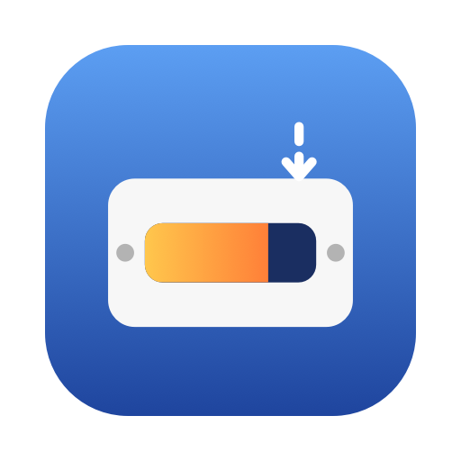
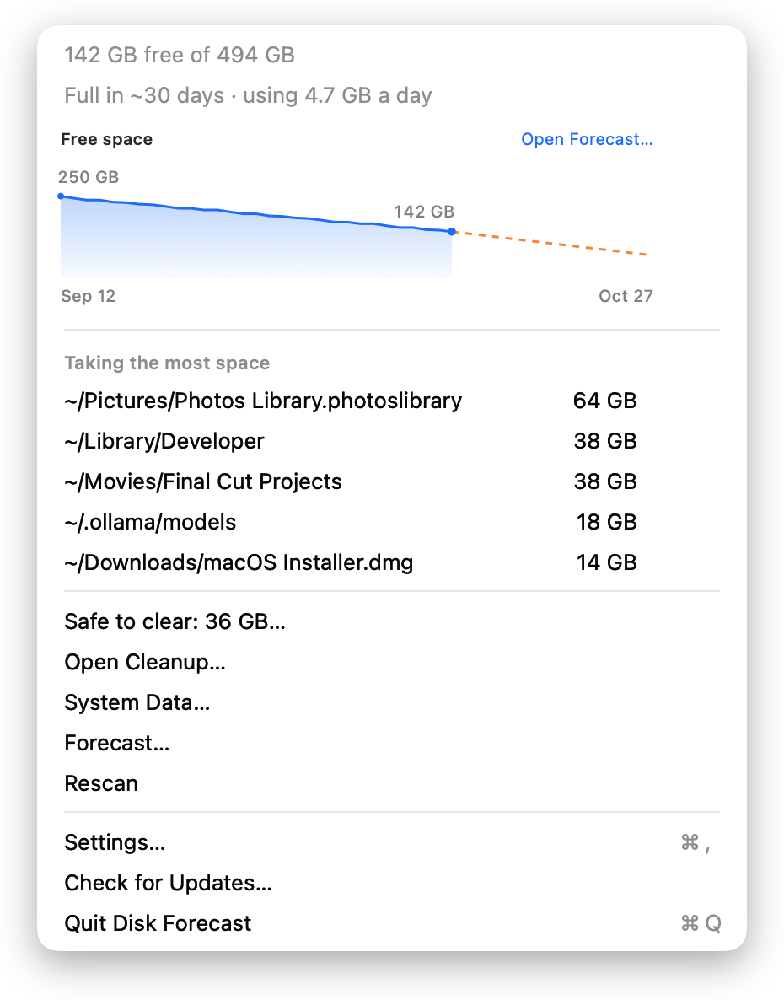
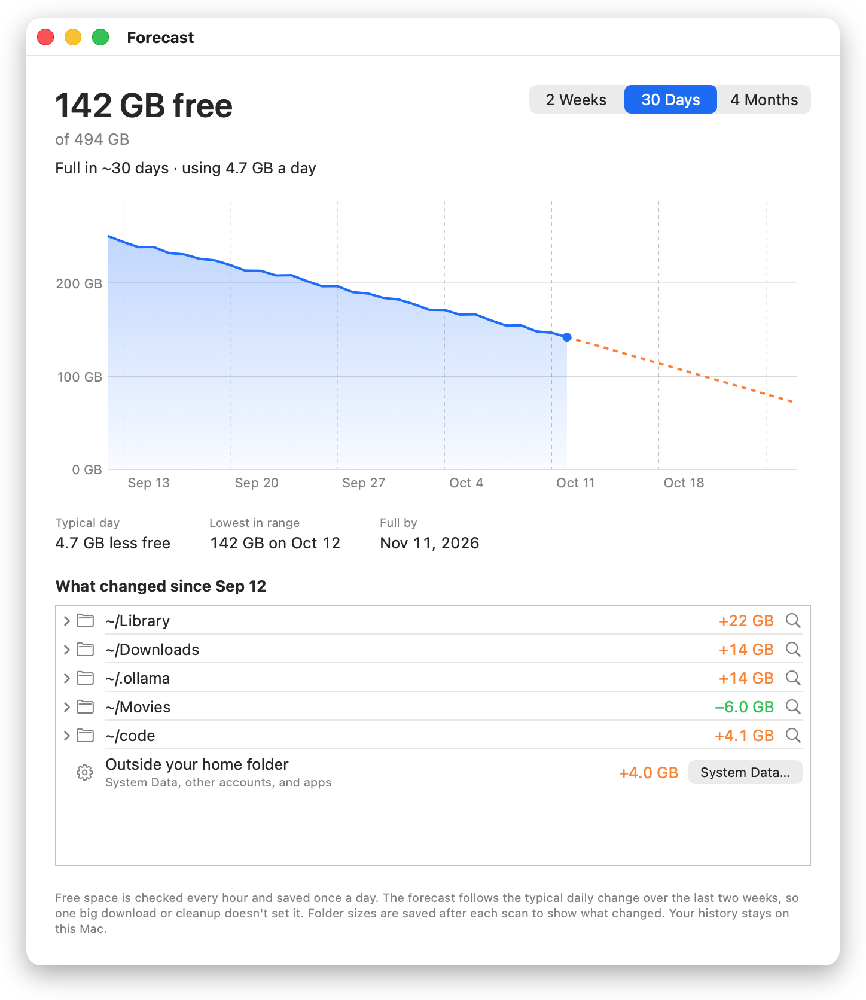
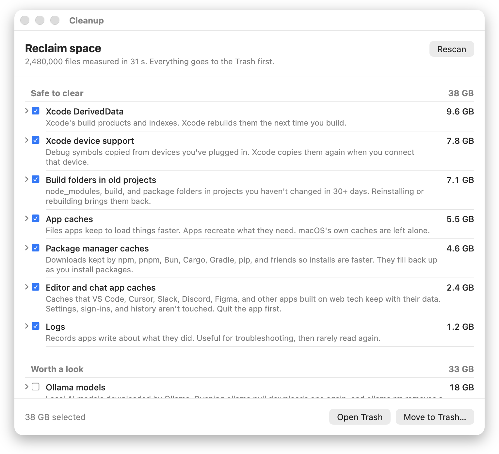

<p align="center">
  
</p>

<h1 align="center">Disk Forecast</h1>

<p align="center">Know before your Mac runs out of space. A free menu bar app that forecasts when your disk will be full, shows what's filling it, and reclaims space safely.</p>

<p align="center">
  <a href="https://diskforecast.com">diskforecast.com</a> ·
  <a href="https://github.com/coreyhaines31/diskforecast/releases/latest">Download</a> ·
  <a href="#install">Install</a> ·
  <a href="#first-run">First run</a> ·
  <a href="#troubleshooting">Troubleshooting</a>
</p>

---

Disk Forecast sits in your menu bar and shows how much space is free. After a few days it knows your pace and tells you when the disk will be full ("Full in ~41 days · using 3.5 GB a day"), shows which folders are growing, and moves what's safe to clear to the Trash. It's free, the source is on GitHub, and nothing about your disk ever leaves your Mac.

It's a free alternative to DiskBuddy, DaisyDisk, and CleanMyMac for the job they're most often bought for: getting disk space back.

<p align="center">
  
</p>

<p align="center">
  <picture>
    <source media="(prefers-color-scheme: dark)" srcset=".github/images/forecast-dark.png">
    
  </picture>
  <picture>
    <source media="(prefers-color-scheme: dark)" srcset=".github/images/cleanup-dark.png">
    
  </picture>
</p>

<p align="center"><sub>Shown with sample data.</sub></p>

## What it does

- **Forecasts when your disk fills.** Free space is checked every hour and saved once a day. The forecast follows your typical daily change over the last two weeks, so one big download or cleanup doesn't throw it off.
- **Shows the trend.** A small chart at the top of the menu, and a Forecast window with 2-week, 30-day, and 4-month views, the projected full date, and the lowest point.
- **Says what changed.** After each scan it saves folder sizes, so it can show which folders grew since any day in the chart, down to the subfolder that did it.
- **Explains System Data.** Local Time Machine snapshots, purgeable space, the Spotlight index, simulators, Apple Intelligence and Siri models, and Docker, each with a fix that uses Apple's or the tool's own command.
- **Reclaims space safely.** Caches, logs, Xcode leftovers, package manager caches, and build folders in old projects are listed as **Safe to clear**. Big downloads, disk images, VMs, and local AI models are **Worth a look** and never selected for you. Files always go to the Trash.
- **Warns you when space is low**, whatever the trend.
- **Counts accurately.** APFS clones and hard links are counted once, so totals match what the disk really spends.
- **Zero telemetry.** Checking for updates is the only time it goes online.

## Install

Requires macOS 14 Sonoma or later, on Apple silicon or Intel.

**Homebrew:**

```sh
brew install --cask coreyhaines31/tap/diskforecast
open -a "Disk Forecast"
```

**Or download:** get `DiskForecast-<version>.dmg` from [Releases](https://github.com/coreyhaines31/diskforecast/releases/latest), open it, and drag **Disk Forecast** to **Applications**. Then open it from Applications.

The app is signed with a Developer ID and notarized by Apple, so it opens without warnings. It updates itself through [Sparkle](https://sparkle-project.org). It isn't on the App Store because the App Store's sandbox can't measure the whole disk.

## First run

1. **Open the app.** It has no Dock icon. Look for a drive icon with your free space (like **142 GB**) in the menu bar, near the clock.
2. **Choose how much it can see.** A window asks for **Full Disk Access**. It's optional:
   - **Open System Settings** → turn on **Disk Forecast** under Privacy & Security › Full Disk Access (click **+** and choose it from Applications if it isn't listed) → come back. The app notices on its own.
   - **Continue with home folder only** to measure just your home folder. Folders macOS guards, like Mail, Messages, and other apps' containers, are skipped and show up as unexplained space.
3. **Allow Desktop, Documents, and Downloads if macOS asks.** Without Full Disk Access, macOS asks once for each of these folders. Click **Allow** so they're included.
4. **Wait for the first scan.** The menu shows **Measuring… N files** while it works. A home folder with a few million files takes one to two minutes. After that it scans twice a day on its own.
5. **Turn on Launch at login** in **Settings… › General**, so the daily readings keep coming.

What to expect over the first days:

| When | What you'll see |
|---|---|
| Right away | Free space, the folders taking the most space, and how much is Safe to clear |
| Day 2 | The chart has its first line |
| Day 3 | The forecast: "Full in ~41 days", "Steady", or "Free space growing" |
| After scans on two different days | **What changed** in the Forecast window, and "Grew most this week" in the menu |

## Using it

Click the menu bar item:

- **Free space and the forecast** at the top, with a **Low on space** warning when you're under 10% (or 20 GB) free. Click the warning to open Cleanup.
- **The chart.** Click it, or choose **Forecast…**, to open the Forecast window.
- **Taking the most space:** the five biggest folders. Click one to show it in Finder.
- **Safe to clear: 12 GB…** moves everything in the Safe to clear group to the Trash, after a confirmation that lists what's included.
- **Open Cleanup…** to review both groups and pick exactly what to move.
- **System Data…** to see what macOS counts as System Data and fix the parts you can.
- **Rescan** to measure again now.

**Getting the space back.** Moving files to the Trash doesn't free space until the Trash is emptied. After a cleanup, check what's there with **Open Trash**, then empty it in Finder when you're sure.

**System Data fixes** run real commands, like `tmutil deletelocalsnapshots` or `xcrun simctl runtime delete`. Each one shows the exact command and asks you to confirm. Some ask for your administrator password.

**Settings:**

- **General:** Launch at login · what the menu bar shows (free space, percent free, or icon only) · automatic update checks.
- **Scanning:** Full Disk Access status · how long a project must be untouched before its build folders count as Safe to clear (30 days by default) · Rescan Now.

## Privacy and safety

- Disk Forecast reads file sizes and names. It never reads file contents.
- Nothing about your disk is sent anywhere. The only network request is the update check, which fetches a small feed from this repo's GitHub releases. You can turn automatic checks off in Settings.
- Files only ever go to the Trash. It refuses anything outside your home folder, your home folder itself, and the standard folders in it (like Documents or Library).
- It never scans cloud drives (iCloud Drive, Dropbox, Google Drive), so it never downloads cloud-only files.
- Its history lives in `~/Library/Application Support/Disk Forecast/`.

## Troubleshooting

**I can't see it in the menu bar.**
On a MacBook with a notch, macOS hides menu bar items that don't fit. Quit an app or two, or ⌘-drag other icons out of the way. Then ⌘-drag Disk Forecast where you want it. If it's not running, open it from Applications.

**It's been "Measuring…" for a long time.**
macOS may be waiting on a permission prompt (Desktop, Documents, or Downloads). Look for the prompt and answer it. Folders still waiting after a few seconds are skipped and measured on their own, so the rest of the scan finishes.

**Its numbers don't match Finder or Storage settings.**
- **Purgeable space:** Finder and Storage settings count purgeable space as available. The System Data window shows how much of it there is.
- **Clones and hard links:** Disk Forecast counts these once, so a folder full of APFS clones can look smaller here than in Finder. That's the space the disk actually uses.
- **Home folder only:** without Full Disk Access, guarded folders aren't measured.

**I cleared space but free space didn't go up.**
Empty the Trash. If it still doesn't go up, local Time Machine snapshots may be holding the deleted files. You can see and remove them in **System Data…**.

**It says "Forecast ready in 2 days".**
It needs three daily readings. Keep it running (turn on Launch at login) and the forecast appears.

**How do I update?**
It checks for updates on its own. You can also choose **Check for Updates…** from the menu, or run `brew upgrade --cask diskforecast`.

**How do I uninstall it?**
Quit it from the menu, then either:

```sh
brew uninstall --cask --zap diskforecast
```

or move **Disk Forecast** from Applications to the Trash, then remove `~/Library/Application Support/Disk Forecast` and `~/Library/Preferences/app.diskforecast.DiskForecast.plist`. Remove it from Full Disk Access in System Settings too, if you added it.

Something else? [Open an issue](https://github.com/coreyhaines31/diskforecast/issues/new/choose).

## Building from source

Requires Xcode 16 or later and [XcodeGen](https://github.com/yonaskolb/XcodeGen).

```sh
git clone https://github.com/coreyhaines31/diskforecast.git
cd diskforecast
brew install xcodegen swiftlint
xcodegen generate                 # creates DiskForecast.xcodeproj from project.yml
```

Run the tests (no signing needed):

```sh
xcodebuild -project DiskForecast.xcodeproj -scheme DiskForecast \
  -derivedDataPath build/DerivedData CODE_SIGNING_ALLOWED=NO test
swiftlint --strict
```

Build an app you can run on your own Mac, signed locally instead of with a team:

```sh
xcodebuild -project DiskForecast.xcodeproj -scheme DiskForecast \
  -derivedDataPath build/DerivedData DEVELOPMENT_TEAM="" CODE_SIGN_IDENTITY="-" build
open "build/DerivedData/Build/Products/Debug/Disk Forecast.app"
```

In Xcode, open `DiskForecast.xcodeproj`, choose your own team (or "Sign to Run Locally") under Signing & Capabilities, and run.

A development build uses the same app ID and data folder as the installed app, so quit one before running the other. Full Disk Access is granted per copy of the app.

**Where things live:**

- `Packages/DiskForecastCore`: the scanner, forecast, cleanup catalog, Trash rules, folder snapshots, and System Data parsers, with unit tests. Most logic changes happen here.
- `DiskForecast/`: the app. The menu, windows, and settings (AppKit and SwiftUI).
- `site/`: the website at diskforecast.com, generated by `python3 site/_build/render.py`.
- `Scripts/`: the release script and the icon renderer.

See [CONTRIBUTING.md](CONTRIBUTING.md) before opening a pull request. Maintainers: releases are covered in [RELEASING.md](RELEASING.md).

## License

[FSL-1.1-MIT](LICENSE) © Corey Haines. Free to use and modify, including at work. You can't resell it or build a competing product from it. Each release becomes MIT two years after it ships.

The Disk Forecast name and icon are covered by the [trademark policy](TRADEMARK.md).
